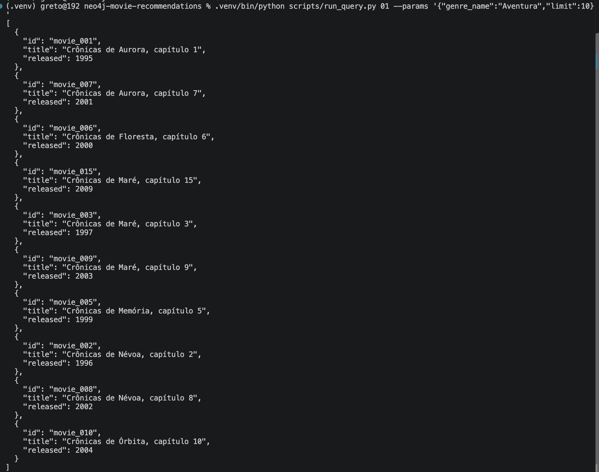
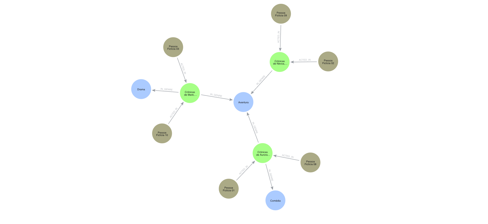
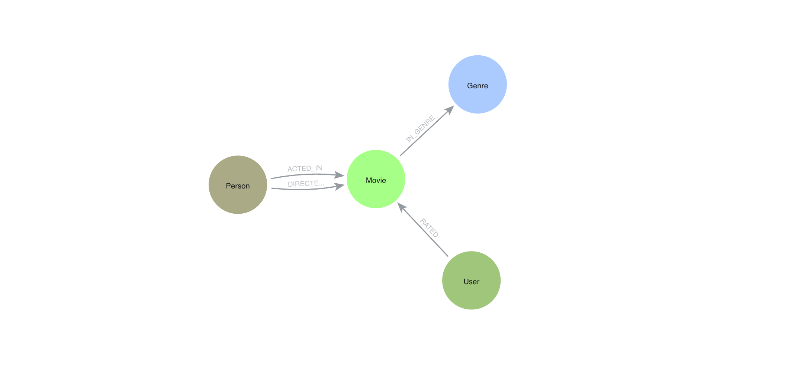
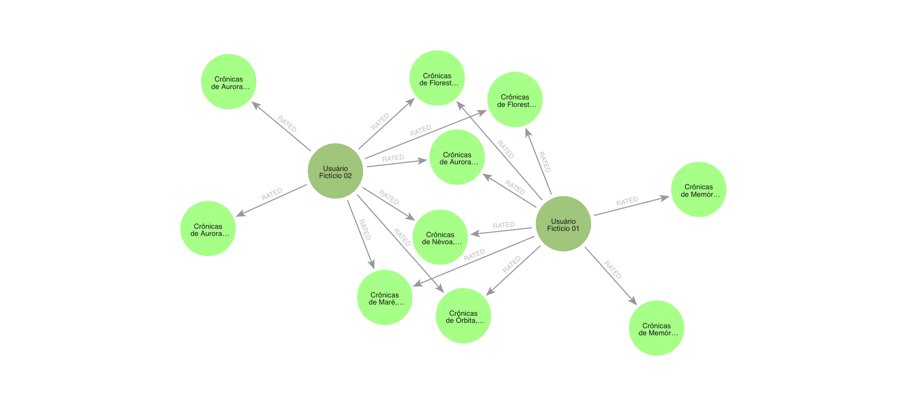

# Recomendação de Filmes com Neo4j

Projeto para explorar recomendações de filmes usando relacionamentos em um
banco de dados em grafo Neo4j.

Encontrar filmes relevantes exige relacionar preferências, avaliações, gêneros
e pessoas envolvidas nas produções. O grafo representa essas conexões diretamente:
permite descobrir filmes de gêneros preferidos, identificar usuários com
favoritos em comum e sugerir títulos ainda não avaliados. As consultas Cypher
também permitem explicar quais conexões contribuíram para cada recomendação.

## Configuração inicial

```sh
python3 -m venv .venv
.venv/bin/python -m pip install -r requirements.txt
```

Use Python 3.9 ou superior e uma instância Neo4j Aura disponível. Execute os
comandos deste README na raiz do repositório. Após instalar, configure o `.env`,
teste a conexão, crie o schema, valide os CSVs, importe e verifique a carga,
nessa ordem. Os scripts usam o driver oficial `neo4j` e `python-dotenv`.

Crie um `.env` na raiz do projeto com `NEO4J_URI`, `NEO4J_USERNAME`,
`NEO4J_PASSWORD` e `NEO4J_DATABASE`. Não compartilhe esse arquivo
nem arquivos de credenciais baixados do Aura.

## Testar a conexão

Na raiz do projeto, execute:

```sh
.venv/bin/python scripts/check_connection.py
```

O teste verifica a conectividade e executa `RETURN 1 AS ok` no banco configurado,
sem criar datasets nem alterar dados. Em caso de falha, termina com código 1
sem exibir dados de autenticação.

O usuário verificou com sucesso a conexão real ao Neo4j Aura e a execução da
consulta `RETURN 1 AS ok` no banco configurado.

## Modelo

O grafo contém filmes (`Movie`), pessoas (`Person`), gêneros (`Genre`) e usuários
(`User`). Pessoas atuam e dirigem filmes; filmes pertencem a gêneros; usuários
avaliam filmes com `rating` numérico entre 0 e 5. Uma pessoa pode atuar e dirigir.

Consulte as propriedades, direções e cardinalidades em [docs/model.md](docs/model.md).

## Criar o schema

Com o `.env` configurado, execute na raiz do projeto:

```sh
.venv/bin/python scripts/create_schema.py
```

O script executa cada arquivo de `cypher/schema/` individualmente, em ordem de
nome, no banco indicado por `NEO4J_DATABASE`. Cria apenas as quatro constraints
de unicidade com `IF NOT EXISTS`, sem criar nós ou relacionamentos. As regras
de tipos, cardinalidades e intervalo de avaliação estão documentadas no modelo
e deverão ser validadas pelos fluxos de escrita de dados.

O usuário executou `scripts/create_schema.py` duas vezes no Aura, ambas com
sucesso.

## Dataset sintético

Os oito CSVs em `data/` são inteiramente fictícios, gerados localmente com a
biblioteca padrão do Python. Não foram extraídos de pessoas, filmes ou avaliações
reais. IDs e conteúdo são determinísticos, sem dependência de rede ou do Aura.
Os arquivos usam UTF-8 e o módulo `csv` preserva acentos e vírgulas nos títulos.

Execute na raiz do projeto:

```sh
.venv/bin/python scripts/generate_dataset.py
.venv/bin/python scripts/validate_dataset.py
.venv/bin/python -m unittest discover -s tests -v
```

| Arquivo | Registros (sem cabeçalho) |
| --- | ---: |
| `data/movies.csv` | 30 |
| `data/people.csv` | 20 |
| `data/genres.csv` | 8 |
| `data/users.csv` | 15 |
| `data/acted_in.csv` | 60 |
| `data/directed.csv` | 30 |
| `data/movie_genres.csv` | 45 |
| `data/ratings.csv` | 120 |

Cada filme tem dois atores distintos, um diretor e um ou dois gêneros distintos.
As mesmas pessoas podem atuar e dirigir. Cada usuário avalia oito filmes e deixa
22 sem avaliar. Três grupos de cinco usuários compartilham quatro favoritos por
grupo, com notas de 4 a 5, além de favoritos individuais que permitem recomendar
filmes ainda não avaliados pelos colegas. Duas avaliações por usuário fora do
bloco favorito recebem notas de 0 a 3.

O validador confere cabeçalhos, campos obrigatórios, chaves, referências,
duplicatas, anos inteiros, notas finitas de 0 a 5, quantidades e cobertura.
Para a cobertura colaborativa, cada usuário deve compartilhar ao menos dois
filmes com nota a partir de 4 com outro usuário e ter um favorito desse colega
ainda não avaliado.

A validação local e os cinco testes passaram. Uma segunda geração produziu
conteúdo idêntico nos oito arquivos. Os testes usam diretórios temporários e
não modificam os CSVs do projeto. A geração e a validação local não acessam o Aura.

## Importar o dataset

Depois de configurar o `.env` e criar o schema, execute na raiz do projeto:

```sh
.venv/bin/python scripts/import_dataset.py
```

O script reutiliza o validador para conferir todo o dataset antes de qualquer
escrita. Os CSVs são lidos localmente pelo Python em UTF-8; `released` é convertido
para inteiro e `rating` para float. As linhas são enviadas como parâmetros para
`UNWIND $rows`, sem necessidade de `LOAD CSV`, hospedagem dos arquivos ou acesso
do servidor Aura ao sistema de arquivos local.

As oito consultas em `cypher/import/` são executadas individualmente, primeiro
as entidades e depois os relacionamentos, em uma única transação gerenciada
com `session.execute_write()` no banco configurado. Os resultados são consumidos
dentro da transação; o sucesso só é informado após sua confirmação. Uma falha
durante a carga reverte as escritas da transação.

`MERGE` identifica entidades pelas chaves únicas e relacionamentos pelos pares
de nós; `SET` atualiza as demais propriedades, incluindo a nota de `RATED`.
Assim, a importação pode ser repetida sem duplicar os dados do projeto. Não há
exclusão de dados nem recriação de constraints.

## Verificar a importação

```sh
.venv/bin/python scripts/verify_import.py
```

O script valida os CSVs locais e usa uma transação de leitura no banco configurado
para comparar entidades, propriedades, relacionamentos e notas. O resumo mostra
itens ausentes, duplicados, valores divergentes e relacionamentos inesperados.
Retorna código 0 quando tudo confere e código 1 em caso de divergência ou falha.

O escopo são as chaves das entidades presentes nos CSVs e os quatro tipos de
relacionamento entre essas entidades, nas direções documentadas. Outros nós e
relacionamentos fora desse escopo, assim como propriedades adicionais, não
interferem na verificação. Nenhum dado é alterado.

### Validação real no Aura

O usuário executou a importação e a verificação no Aura, confirmando 30 filmes,
20 pessoas, 8 gêneros e 15 usuários, além de 60 atuações, 30 direções,
45 associações de gênero e 120 avaliações.

O `verify_import.py` passou antes e depois de repetir a importação. Nenhuma
ausência, duplicação ou divergência foi encontrada, confirmando a idempotência
da carga no cenário verificado pelo usuário.

## Consultas de negócio

As dez consultas em `cypher/queries/` cobrem catálogo, filmografias, avaliações,
preferências, recomendações por gênero e colaborativas, semelhança entre filmes,
pares de atores e caminhos entre pessoas. São consultas somente de leitura.

Execute pelo identificador, passando os parâmetros como objeto JSON:

```sh
.venv/bin/python scripts/run_query.py 01 --params '{"genre_name":"Aventura","limit":10}'
```

O executor valida parâmetros, usa o banco do `.env` e imprime JSON. Para também
exportar em UTF-8, acrescente `--output /tmp/resultado.json`. Consulte as perguntas,
pontuações e exemplos completos em [docs/queries.md](docs/queries.md).
As dez consultas foram executadas com sucesso pelo usuário no Aura. Os JSONs
exportados em `docs/results/` foram inspecionados localmente, incluindo a
ausência de filmes já avaliados e de duplicatas nas duas recomendações.

Para executar os dez exemplos e exportar um JSON por consulta:

```sh
.venv/bin/python scripts/run_all_queries.py
```

O comando cria `docs/results/` se necessário e substitui os resultados anteriores
com os mesmos nomes quando cada consulta conclui com sucesso. As contagens
observadas e os parâmetros usados estão em [docs/queries.md](docs/queries.md).

### Evidência da consulta 01



Consulta de filmes do gênero Aventura executada pelo Python contra o Neo4j Aura,
com os resultados JSON exibidos no terminal.

## Visualizações do grafo

Os prints abaixo foram fornecidos pelo usuário. As consultas de leitura
associadas permitem visualizar os recortes correspondentes no cliente gráfico
do Neo4j; os comandos originais e a disposição visual dos nós não estão
registrados nas imagens. Esses comandos são executados no editor Cypher do
cliente, não pela lista de consultas permitidas de `run_query.py`.

### Atores, filmes e gêneros



Pessoas que atuam nos três primeiros filmes e os gêneros desses filmes,
evidenciando as conexões `ACTED_IN` e `IN_GENRE`.

```cypher
MATCH p = (person:Person)-[:ACTED_IN]->(movie:Movie)-[:IN_GENRE]->(genre:Genre)
WHERE movie.id IN ['movie_001', 'movie_002', 'movie_003']
RETURN p
ORDER BY movie.id, person.id, genre.name
LIMIT 30;
```

### Modelo do grafo



Visão dos labels e direções dos quatro tipos de relacionamento, incluindo os
papéis de atuação e direção representados por uma mesma `Person`.

```cypher
CALL db.schema.visualization();
```

O procedimento nativo apresenta a estrutura do banco selecionado e pode incluir
outros labels caso a instância contenha dados além deste projeto.

### Usuários e avaliações



Avaliações dos usuários fictícios 01 e 02, mostrando filmes em comum e outros
avaliados por apenas um deles. O valor numérico de cada nota está em `r.rating`,
embora o print mostre apenas o tipo `RATED` nas arestas.

```cypher
MATCH (u:User)-[r:RATED]->(m:Movie)
WHERE u.id IN ['user_001', 'user_002']
RETURN u, r, m
ORDER BY u.id, m.id
LIMIT 30;
```

## Limitações e entrega

O dataset é fictício e pequeno: serve para demonstrar modelagem e consultas,
sem comprovar qualidade de recomendação em cenários reais ou desempenho em
escala. As recomendações seguem regras explícitas em Cypher, sem treinamento
de modelos de aprendizado de máquina. O projeto é operado por scripts de linha
de comando e pelo cliente do Neo4j; não inclui API nem interface própria.

As constraints garantem unicidade das chaves. Tipos, cobertura e intervalo das
notas são conferidos pelo validador do dataset, não por essas constraints.

Uma descrição curta para a entrega está em [docs/entrega-dio.md](docs/entrega-dio.md).
