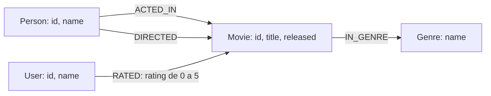

# Modelo de recomendação de filmes

## Nós e propriedades

Todas as propriedades abaixo são esperadas no modelo. Os identificadores são
strings, mesmo quando representam valores numéricos.

| Label | Propriedades | Chave única |
| --- | --- | --- |
| `Movie` | `id`: string; `title`: string; `released`: inteiro (ano de lançamento) | `id` |
| `Person` | `id`: string; `name`: string | `id` |
| `Genre` | `name`: string | `name` |
| `User` | `id`: string; `name`: string | `id` |

Uma mesma `Person` pode atuar e dirigir, inclusive o mesmo filme. Os papéis são
representados pelos relacionamentos `ACTED_IN` e `DIRECTED`, sem labels separados.

## Relacionamentos e cardinalidades esperadas

| Direção | Propriedades | Cardinalidade |
| --- | --- | --- |
| `(Person)-[:ACTED_IN]->(Movie)` | Nenhuma | Uma pessoa atua em 0..N filmes; um filme tem 0..N pessoas no elenco. |
| `(Person)-[:DIRECTED]->(Movie)` | Nenhuma | Uma pessoa dirige 0..N filmes; um filme tem 0..N diretores. |
| `(Movie)-[:IN_GENRE]->(Genre)` | Nenhuma | Um filme pertence a 0..N gêneros; um gênero reúne 0..N filmes. |
| `(User)-[:RATED]->(Movie)` | `rating`: número entre 0 e 5, inclusive; aceita valores fracionários | Um usuário avalia 0..N filmes; um filme recebe avaliações de 0..N usuários. |

Espera-se no máximo um relacionamento de cada tipo por par de nós. Em particular,
uma nova avaliação do mesmo usuário para o mesmo filme deve atualizar o `rating`
da avaliação existente. Nós podem existir antes de receber relacionamentos.

## Diagrama

## Schema e validação

Os quatro arquivos em `cypher/schema/` criam constraints de unicidade para
`Movie.id`, `Person.id`, `Genre.name` e `User.id`, com `IF NOT EXISTS` para permitir
execuções repetidas.

Essas constraints garantem apenas unicidade das propriedades presentes. A
obrigatoriedade e os tipos das propriedades, as cardinalidades, a ausência de
relacionamentos duplicados e o intervalo numérico de `rating` são regras do
modelo que deverão ser validadas nos futuros fluxos de escrita de dados; não são
impostos pelas quatro constraints desta etapa.
